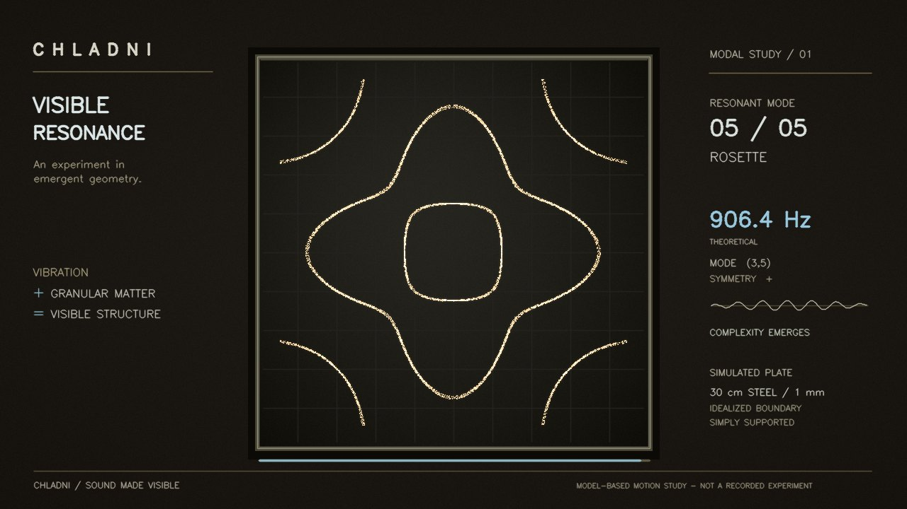

# CHLADNI — Visible Resonance

An interactive motion laboratory inspired by the Chladni plate experiment. Explore the patterns created by idealized standing-wave modes on a square plate, and watch simulated grains assemble near the nodal lines.

## Experience

- Explore five resonance geometries: Diagonal, Circle, Curvature, Lattice, Rosette.
- Adjust excitation and sand-grain count.
- Reveal the modeled vibration field and cycle through modes automatically.
- Start/stop the synthesized tone, pause, save a PNG, and record a silent WebM video (browser support varies).
- Works with modern desktop and mobile browsers; higher grain counts may be slower on phones.

**Scientific scope:** An illustrative model, not a recording of a physical experiment. The nodal patterns come from analytical mode shapes for an idealized simply supported square plate; grain movement uses a stylized transport simulation. Frequencies shown are theoretical estimates, not measured resonance frequencies.

The source files are public if published in a public GitHub repository. The repository does not include a license. If you want others to reuse or modify the code, choose and add a suitable open-source license separately.
